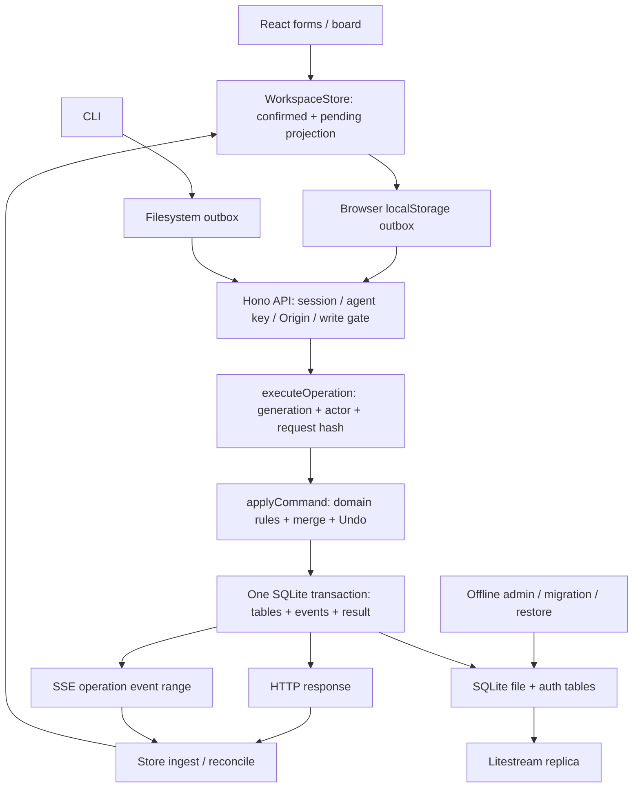

# TaskIndex v2 — независимое ревью архитектуры

Дата: 2026-09-08. Reviewer 2, Astra xhigh. Объект — текущее рабочее дерево `/Users/dmitriy/code/taskindex`, включая незакоммиченные `src`, `tests`, `deploy` и `drizzle/v2`. `HEAD 4b780e4` не использовался как реализация v2. Код, конфиги и рабочие данные не менялись.

**Вывод: основное архитектурное решение подходит этому продукту. Переписывать его ещё раз или менять SQLite на PostgreSQL сейчас не требуется.** Общий исполнитель команд, транзакционная фиксация результата и событий, агентский API без браузера и простой VPS составляют разумную основу личной доски. Неполны отдельные гарантии на стыках клиента, журнала и эксплуатации. Главная цена реализации — привязка практически каждой операции к полному пространству и полной истории, а также отсутствие явного контракта развития всех сохранённых представлений модели.

В собственной части подтверждён один функциональный дефект A-01; A-02 — воспроизводимый риск роста, A-03/A-04 — риски следующих изменений, A-05 — необязательное улучшение. Сквозные дефекты, независимо найденные и проверенные в других частях текущего ревью, перечислены отдельно, без повторных A-ID.

## Что выбрано и реализовано удачно

| Решение | Оценка и граница применимости |
|---|---|
| Один Hono/Node процесс и локальный SQLite | Соответствует одному владельцу и нескольким агентам. В проекте нет требования к множеству серверов записи. SQLite допускает один writer на файл; для этого контура это управляемое ограничение, если операции короткие. [Официальные критерии SQLite](https://www.sqlite.org/whentouse.html). |
| React SPA + API, общий `shared` | Агенты могут выполнять операции без открытого браузера. UI и API используют один набор команд, проверок и правил Focus/поиска. Это реальное разделение по обязанностям, а не только по папкам. |
| Pure `applyCommand` и отдельный executor | Команда получает state, actor, clock, IDs, history и возвращает state/effects/result. Тестам не нужен сервер, а сервер сохраняет контроль над транзакцией. См. [commands.ts:225](/Users/dmitriy/code/taskindex/src/shared/commands.ts:225), [operations.ts:35](/Users/dmitriy/code/taskindex/src/server/operations.ts:35). |
| State + events + operation result в одной `BEGIN IMMEDIATE` | Сервер не подтверждает состояние отдельно от журнала и результата для повторов. Пакет сначала вычисляется целиком, затем сохраняется; одинаковый operation ID связан с actor и canonical hash. См. [operations.ts:51](/Users/dmitriy/code/taskindex/src/server/operations.ts:51), [operations.ts:171](/Users/dmitriy/code/taskindex/src/server/operations.ts:171). |
| Field-level conflict checking | Неизменённые другим автором поля можно сохранить с устаревшей ревизией. Перемещения дополнительно проверяют orderKey, инварианты области/проекта и порядка выполняются до commit. Это полезнее безусловного отказа по любому revision mismatch. |
| Origin и ручные решения | Dedup по `(system, ref)`, сравнение упорядоченной версии источника, запрет перезаписи protected fields и сохранение технического состояния при Undo соответствуют агентскому сценарию. |
| Комментарии отдельной сущностью | Комментарий не создаёт ложный конфликт редактирования карточки. Soft delete/Undo имеет самостоятельную ревизию и права автора. |
| SSE с атомарными границами операции | У событий есть `firstSeq/lastSeq`; store ждёт полный диапазон, учитывает разницу между полученным и применённым курсором и не снимает optimistic слой на первом событии пакета. См. [store.ts:192](/Users/dmitriy/code/taskindex/src/web/app/store.ts:192). |
| Явная durable outbox CLI | Конверт сохраняется до отправки через файл 0600, fsync и atomic no-overwrite publication. Ротация ключей не меняет actor агента. Это реальная поддержка неизвестного исхода, хотя валидацию подтверждения ещё нужно исправить. |
| Развёртывание с `writes: held` | Проверка схемы, закрытая запись до health/replica, граница до вызова `open-writes`, остановка обоих процессов перед физической заменой, новая generation и отдельная история репликации — продуманный каркас восстановления. |
| Строгий JSON import | Проверяет не только форму JSON и внешние ключи, но и целостность событий, диапазоны операций, предыдущие значения и совпадение replay с таблицами. Такой валидатор следует сохранить. |

## Фактический путь данных

Это command-oriented monolith с журналом изменений и optimistic projection. Журнал, однако, стал частью корректности системы: он нужен для merge/Undo и обязательного replay при импорте. Поэтому обслуживание истории уже имеет цену, похожую на системы с восстановлением состояния из событий, хотя текущие таблицы остаются основным источником чтения.

## A-01 — оптимистичная ревизия становится серверной предпосылкой следующего сохранения

**P2 · подтверждённый баг · confidence high.**

Сценарий: владелец перемещает задачу; запрос ещё не дошёл до сервера. В это время он открывает карточку и сохраняет заметку. Первая операция повысила ревизию только в optimistic projection. Редактор принимает эту ревизию за прочитанную серверную; второй запрос может прийти раньше первого и получает окончательный `400 invalid: Базовая версия из будущего`.

Причинная цепочка:

1. [store.ts:88](/Users/dmitriy/code/taskindex/src/web/app/store.ts:88) использует `applyCommand` для preview, включая увеличение `revision` в [commands.ts:256](/Users/dmitriy/code/taskindex/src/shared/commands.ts:256).
2. `pendingTask` блокирует карточечные действия, но [card.tsx:103](/Users/dmitriy/code/taskindex/src/web/app/card.tsx:103) сохраняет активную кнопку открытия карточки.
3. [shell.tsx:665](/Users/dmitriy/code/taskindex/src/web/app/shell.tsx:665) передаёт `selected` из отображаемых данных редактору; [editor.tsx:114](/Users/dmitriy/code/taskindex/src/web/app/editor.tsx:114) и [editor.tsx:118](/Users/dmitriy/code/taskindex/src/web/app/editor.tsx:118) инициализируют `draft/saved` этим объектом.
4. Редактор блокируется только своим `busy`, [editor.tsx:300](/Users/dmitriy/code/taskindex/src/web/app/editor.tsx:300). [use-workspace.ts:24](/Users/dmitriy/code/taskindex/src/web/lib/use-workspace.ts:24) ставит `baseRevision: base.revision`.
5. Store независимо отправляет новый конверт, [store.ts:325](/Users/dmitriy/code/taskindex/src/web/app/store.ts:325), а сервер правильно запрещает revision из будущего, [commands.ts:132](/Users/dmitriy/code/taskindex/src/shared/commands.ts:132).

Проверка: собственный [02-architecture-probes.mts](/Users/dmitriy/code/taskindex/docs/audits/2026-09-08-multiside-review/02-architecture-probes.mts), результат [02-architecture-probes.json](/Users/dmitriy/code/taskindex/docs/audits/2026-09-08-multiside-review/02-architecture-probes.json). Настоящий executor и SQLite `:memory:`, задержана только первая доставка. `confirmedRevision=1`, `editorBaseRevision=2`; второе сохранение отвергнуто, затем перемещение успешно фиксируется revision 2. Заметка второй команды в базе отсутствует. Это не утверждение об утрате черновика: проверено отклонение сохранения; UI-путь до редактора подтверждён чтением кода, отдельный browser replay здесь не запускался.

Рекомендация: хранить базу редактирования из `confirmed`; для задачи с pending показывать состояние ожидания и не разрешать зависимое сохранение до его разрешения. Простая блокировка сохранения дешевле очереди зависимостей. Если продукту нужна последовательность локальных намерений без ожидания, реализовать её в store явно: зависимость от operation ID, отправка после подтверждения и пересмотр базовой версии. Одна лишь сериализация HTTP-запросов без пересмотра предпосылок недостаточна, потому что первая команда может быть отвергнута.

## A-02 — маленькая операция обрабатывает всё пространство и всю историю

**P2 · архитектурный риск роста, текущая стоимость воспроизводится · confidence high.** В общем итоговом списке это одна проблема вместе с соответствующей находкой stack reviewer.

Каждая новая команда, включая no-op и комментарий, выполняет полный `readState` и полный `readEvents`: [operations.ts:93](/Users/dmitriy/code/taskindex/src/server/operations.ts:93). В `readState` каждый task заново фильтрует все checklist items и все comments, [db.ts:118](/Users/dmitriy/code/taskindex/src/server/db.ts:118). Затем каждая команда клонирует всё пространство, [commands.ts:233](/Users/dmitriy/code/taskindex/src/shared/commands.ts:233). В конце `writeState` для каждой текущей записи ищет её прежнюю через `find` и сериализует обе: [db.ts:170](/Users/dmitriy/code/taskindex/src/server/db.ts:170), [db.ts:191](/Users/dmitriy/code/taskindex/src/server/db.ts:191), [db.ts:223](/Users/dmitriy/code/taskindex/src/server/db.ts:223).

Таким образом, стоимость не просто O(размер задачи): она включает историю O(E), соединение данных O(T×(C+I)), сравнение задач O(T²), а пакет ещё повторяет clone/invariant passes. Удаление комментария также меняет производный `commentCount` и попадает в полное переписывание строки задачи и её чеклиста, хотя её предметная ревизия не растёт.

Чтение усугубляет тот же эффект. [app.ts:736](/Users/dmitriy/code/taskindex/src/server/app.ts:736) ищет одну операцию после `readOperations` всех операций. Последний распаковывает все сохранённые результаты и выполняет до трёх дополнительных SELECT заголовков на операцию: [db.ts:235](/Users/dmitriy/code/taskindex/src/server/db.ts:235). Пагинация режет уже загруженный массив; [app.ts:205](/Users/dmitriy/code/taskindex/src/server/app.ts:205) дополнительно хеширует его целиком. SSE backlog тоже берётся целиком, [app.ts:851](/Users/dmitriy/code/taskindex/src/server/app.ts:851).

Новый изолированный замер stack reviewer, прочитанный после независимого анализа кода: [01-stack-bench.json](/Users/dmitriy/code/taskindex/docs/audits/2026-09-08-multiside-review/01-stack-bench.json). При 100/1 000/5 000 tasks медиана одиночного update была примерно 1,3/8,5/63 мс. При одной задаче и 50 000 событий — около 250 мс, full-scan lookup operation — около 1 039 мс. Это Node 24, macOS arm64, in-memory SQLite, синтетическая история, не валидный экспорт; без сети, auth и fsync. Замер доказывает направление зависимости, не задаёт SLA рабочего VPS. Собственный дублирующий benchmark не запускался.

В одном Node процессе длительная синхронная работа задерживает и другие запросы/доставку SSE; это описано в [официальном объяснении event loop](https://nodejs.org/en/learn/asynchronous-work/dont-block-the-event-loop). Архив и история по контракту не удаляются, поэтому нагрузка зависит от всей жизни пространства, даже если на доске десять задач.

Рекомендация по этапам:

1. Сначала Map для присоединения comments/checklist и поиска previous records; точечный `operation get`; SQL пагинация summaries без полного `result`.
2. Затем repository methods для затронутых задач/проектов/соседей и истории конкретной сущности после `baseRevision`; Undo загружает события указанной операции и необходимые поздние изменения.
3. Пусть executor пишет фактически изменённые records/effects, сохраняя одну транзакцию. Pure core и property tests можно оставить.
4. Snapshot полного небольшого пространства пока допустим. Усложнение транспорта, отдельный сервер БД или несколько процессов раньше исправления этих обходов причины не устраняют.

## A-03 — версия таблиц не задаёт совместимость истории, ответов и открытого клиента

**P2 · архитектурный риск будущих миграций · confidence high. Текущая v1-база не объявляется повреждённой.**

В `operations.result` сохраняются полные `OperationResponse`, включая записи, а в `events.changes` — предыдущие/новые значения: [schema.ts:109](/Users/dmitriy/code/taskindex/src/server/schema.ts:109), [schema.ts:130](/Users/dmitriy/code/taskindex/src/server/schema.ts:130). У отдельных event/result нет версии формата. `exportSchema` использует текущие strict schemas задач/проектов/комментариев, [domain-schemas.ts:270](/Users/dmitriy/code/taskindex/src/shared/domain-schemas.ts:270). Import воспроизводит все события и требует точного равенства текущим таблицам, [admin.ts:282](/Users/dmitriy/code/taskindex/src/server/admin.ts:282), [admin.ts:359](/Users/dmitriy/code/taskindex/src/server/admin.ts:359).

Мигратор выполняет SQL-файлы и ставит общий `schema_version`, [db.ts:77](/Users/dmitriy/code/taskindex/src/server/db.ts:77); поколение меняет только при первичной инициализации, [db.ts:89](/Users/dmitriy/code/taskindex/src/server/db.ts:89). Открытый UI при той же generation не пересоздаёт SSE, [sync.ts:9](/Users/dmitriy/code/taskindex/src/web/app/sync.ts:9). Snapshot не несёт protocol/schema version, [domain-schemas.ts:144](/Users/dmitriy/code/taskindex/src/shared/domain-schemas.ts:144).

Последствие: при добавлении обязательного поля, изменении enum или data migration разработчику недостаточно корректного `ALTER TABLE/UPDATE`. Старые creation events не содержат новый default, старые operation results остаются старой формы, replay может расходиться с таблицами, старый браузер продолжает принимать новый контракт. Перегенерировать только Drizzle SQL и поднять `SCHEMA_VERSION` не замыкает эту цепочку.

Собственный probe намеренно моделирует только row-transform часть будущей data migration на `:memory:`: после валидного создания и успешного export/import выполняется SQL-нормализация поля note без миграции истории. `/health` остаётся healthy, export формируется, import этого экспорта отказывается с `состояние записей не совпадает с журналом событий`. [Артефакт](/Users/dmitriy/code/taskindex/docs/audits/2026-09-08-multiside-review/02-architecture-probes.json). Это проверка скрытого требования, а не обход существующей безопасности: отказ импортера полезен и ожидаем.

Рекомендация до первого изменения доменной схемы: выбрать и зафиксировать один небольшой контракт. Либо миграция атомарно преобразует таблицы, журнал и сохранённые ответы, либо появляются versioned codecs/upcasters, которыми одинаково пользуются API, replay и import. Не переписывать idempotency outcome случайным образом: его принадлежность исходному запросу должна оставаться проверяемой. Для несовместимого API нужен явный сигнал старому UI обновиться; не полагаться на schema flag, который проверяет только новый сервер. Контрольная фикстура должна содержать хотя бы старое создание, edit, комментарий, Undo, успешную no-op и отказ; после миграции проверяются старый operation get, повтор исходного конверта и export/import.

## A-04 — восстановление фиксирует образ и базу, но использует конфигурацию кандидата

**P2 · архитектурный риск следующих релизов · confidence medium-high. Не утверждение о провале текущего Docker drill.**

`deploy.sh` делает `git checkout --detach target`, [deploy.sh:40](/Users/dmitriy/code/taskindex/deploy/deploy.sh:40). Функция `dc` всегда читает compose по пути текущего checkout, [common.sh:15](/Users/dmitriy/code/taskindex/deploy/common.sh:15). В manifest сохраняются image/build/deployment/backup/replica и metadata, но не версия/копия compose, config репликатора или helper scripts, [deploy.sh:70](/Users/dmitriy/code/taskindex/deploy/deploy.sh:70). При откате запускается `rollback.sh` из checkout кандидата, [deploy.sh:51](/Users/dmitriy/code/taskindex/deploy/deploy.sh:51), а он подставляет старый image в тот же compose, [rollback.sh:38](/Users/dmitriy/code/taskindex/deploy/rollback.sh:38).

Если один из следующих релизов меняет volume mapping, переменную пути БД, конфигурацию Litestream или соглашение helper CLI, старый image + прежняя база больше не гарантируют прежний работающий контур. Даже остановка сервисов/поиск нужного volume зависят от файлов кандидата. Это не проблема секретов: секреты должны оставаться вне release artifact.

Текущий drill проверяет полезный, но более узкий сценарий: создаёт несовместимую таблицу/`schema_version=999`, сохраняя тот же образ и compose, [local-drill.sh:79](/Users/dmitriy/code/taskindex/deploy/local-drill.sh:79). Он не является проверкой возврата между разными release configurations.

Рекомендация: хранить release directory или небольшой manifest с неизменяемыми compose/litestream/helper artifacts обеих сторон. Явно определить версию orchestrator, которая останавливает текущий релиз, и версию, которая поднимает восстановленный. Репетиция должна включать две сборки с контролируемым изменением конфигурации, а не только неверный schema flag. Отдельная платформа деплоя для этого не нужна.

## A-05 — добавление команды не требует от TypeScript добавить её обработку

**P3 · необязательное улучшение сопровождения · confidence high.**

Схемы команд точные, но `applyCommand` сразу превращает payload в `Record<string, unknown>`, далее использует строковые ветвления и casts: [commands.ts:230](/Users/dmitriy/code/taskindex/src/shared/commands.ts:230), [commands.ts:387](/Users/dmitriy/code/taskindex/src/shared/commands.ts:387), [commands.ts:453](/Users/dmitriy/code/taskindex/src/shared/commands.ts:453). Последний `else` для задач по умолчанию трактует команду как работу с чеклистом, [commands.ts:602](/Users/dmitriy/code/taskindex/src/shared/commands.ts:602). Новый член command union не вызывает compile-time ошибку из-за отсутствующего handler. Это лишняя ручная обязанность при требовании полного паритета будущих возможностей API/UI/CLI.

Текущий набор команд работает; сам размер файла не является багом. При следующем расширении полезны исчерпывающий `switch` по discriminated union или типизированный handler registry, а разделение по task/project/comment/undo — только там, где оно сохраняет общий контекст транзакции и права. Это даст точные типы payload и проверяемую полноту без framework для CQRS.

## Сквозные дефекты из общего текущего ревью

Ниже совпадения и последствия на уровне архитектуры; отдельные воспроизведения находятся в новых [03-probe-results.json](/Users/dmitriy/code/taskindex/docs/audits/2026-09-08-multiside-review/03-probe-results.json), [03-id-probe-results.json](/Users/dmitriy/code/taskindex/docs/audits/2026-09-08-multiside-review/03-id-probe-results.json) и [03-storage-probe-result.json](/Users/dmitriy/code/taskindex/docs/audits/2026-09-08-multiside-review/03-storage-probe-result.json). Эти пункты не следует суммировать второй раз с findings bug reviewer.

| Место разрыва гарантии | Что независимо видно в коде | Практическое следствие / правильная граница исправления |
|---|---|---|
| Snapshot refresh поверх живых событий | [store.ts:155](/Users/dmitriy/code/taskindex/src/web/app/store.ts:155) безусловно заменяет confirmed/seq и очищает buffer; [sync.ts:9](/Users/dmitriy/code/taskindex/src/web/app/sync.ts:9) сохраняет текущий stream при той же generation. | Более старый HTTP snapshot способен стереть уже доставленное SSE изменение; stream уже считает его доставленным. Refresh должен согласовывать watermark и буфер событий, а не только иметь single-flight. |
| Подтверждение CLI outbox | [client.ts:41](/Users/dmitriy/code/taskindex/src/cli/client.ts:41), [client.ts:144](/Users/dmitriy/code/taskindex/src/cli/client.ts:144) считают произвольный HTTP 2xx JSON без `ok:false` успехом и удаляют конверт. | Typed API call не является runtime proof принятой операции. Перед удалением нужны operation-response schema, matching operation ID/generation и корректный статус; непонятный JSON оставляет unknown. |
| Digest и операции без событий | [app.ts:717](/Users/dmitriy/code/taskindex/src/server/app.ts:717), [app.ts:963](/Users/dmitriy/code/taskindex/src/server/app.ts:963) фильтруют по `(lastSeq ?? 0) > since`. | Отказы и успешные no-op не имеют event seq и никогда не входят в digest/since. У operation feed должен быть собственный монотонный курсор; domain seq остаётся курсором state sync. SSE invalidation hints без `id` полезны UI, но не заменяют resumable operation feed для CLI. |
| Терминальные ошибки из invariant validation | [commands.ts:217](/Users/dmitriy/code/taskindex/src/shared/commands.ts:217) бросает `ZodError`, executor сохраняет только `DomainError`, [operations.ts:123](/Users/dmitriy/code/taskindex/src/server/operations.ts:123). | Формально допустимая команда, нарушившая лимит итогового состояния, может получить окончательный отказ без сохранённого operation outcome. Ошибки доменного результата должны приводиться к единой терминальной модели внутри executor; parse errors самого конверта — отдельный контракт. |
| Отзыв доступа к живому SSE | Проверка actor происходит в middleware [app.ts:305](/Users/dmitriy/code/taskindex/src/server/app.ts:305), подписчик [app.ts:810](/Users/dmitriy/code/taskindex/src/server/app.ts:810) затем не перепроверяет сессию/ключ. | Свежий запрос отозванного ключа получает 403, существующее соединение продолжает получать новые данные. Нужен ограниченный срок stream или периодическая/событийная проверка доступа с закрытием. |
| Недоступное хранилище browser outbox | [drafts.ts:8](/Users/dmitriy/code/taskindex/src/web/app/drafts.ts:8) превращает SecurityError получения localStorage в `undefined`; [store.ts:120](/Users/dmitriy/code/taskindex/src/web/app/store.ts:120) пропускает persist через optional chaining и разрешает отправку. | После reload исчезают и неподтверждённый конверт, и неперсистентный черновик. Outbox должен иметь обязательную durable-capability для отправки; режим без хранилища не может молча обещать те же гарантии. |
| Идентификаторы пересекаются со служебными значениями | Общий [idSchema:3](/Users/dmitriy/code/taskindex/src/shared/schemas.ts:3) разрешает `none`, `all`, `by-origin`. [queries.ts:119](/Users/dmitriy/code/taskindex/src/shared/queries.ts:119) интерпретирует первые два как специальные фильтры, [app.ts:593](/Users/dmitriy/code/taskindex/src/server/app.ts:593) перехватывает `by-origin` как статический route перед чтением задачи по ID. | Валидно созданный проект с ID `none` не читается своим фильтром; задача `by-origin` не читается обычным `task get`. Нужна единая граница namespace: typed фильтры или запрет зарезервированных IDs при создании/импорте плюс непересекающаяся схема routes. |

Эти дефекты не требуют смены SSE, SQLite или Hono. Они требуют точных правил принятия результата, порядка синхронизации и жизненного цикла авторизации.

## Что и на что менять

| Сейчас | На что поменял бы | Что даст |
|---|---|---|
| React/Vite + Hono, локальный SQLite, один процесс | Оставить | Небольшое число эксплуатационных компонентов и понятный общий путь человека/агента |
| Optimistic entity используется как editing base | Confirmed base и явная блокировка/зависимость pending | Второе действие не отправляет вымышленную серверную ревизию |
| Полный state/history на любую команду | Сначала Map и точечные read methods, затем persistence по effects | Стоимость маленькой правки перестаёт зависеть квадратично от всего архива |
| Один event seq для state и operation digest | Отдельный cursor операций | Отказы и no-op становятся видимыми при догоне агента |
| Объект JSON со статусом 200 считается подтверждением | Валидированный ответ именно исходной операции | Durable outbox завершается только при установленном исходе |
| Только schema_version таблиц | Минимальный versioned contract для events/results/import и старого UI | Следующее изменение модели не ломает восстановление и открытые вкладки |
| Старый образ запускается с текущим compose | Неизменяемый release artifact для обеих сторон отката | Предыдущая рабочая конфигурация действительно восстанавливается |
| Мониторинг backup в основном во время deploy/drill | Маленькая регулярная проверка возраста подтверждённой реплики и свободного диска | Поломка резервирования видна до аварии; это также замечание stack reviewer, здесь без второго finding |

## Порядок улучшений

1. До реального использования закрыть установленные разрывы гарантий: snapshot/SSE race, runtime validation результата CLI, SSE revoke, нормализация терминальных domain errors и A-01. Это узкие исправления с конкретными regression cases.
2. Сделать operation feed полным для digest/since и устранить самые дешёвые full scans/N+1. Проверить на разумной искусственной истории, включающей архив и комментарии; не выводить производственный SLA из in-memory benchmark.
3. До первой доменной миграции зафиксировать A-03 и прогнать миграцию копии предыдущей версии с export/import, Undo и idempotent replay.
4. До первого рабочего обновления проверить A-04 на двух release artifacts и выбранном S3 backend. Существующий локальный drill — полезная часть этой проверки, а не вся проверка.
5. A-05 выполнять вместе со следующей новой командой. Смена библиотек, глобальный framework state-management или отдельные сервисы пока не имеют доказанного выигрыша.

## Покрытие и пределы проверки

Прочитаны актуальные README/план, `shared` commands/schemas/queries, SQLite schema/repository/executor, API/auth/SSE, browser store/sync/API adapter, связка карточка/редактор/use-workspace, CLI/outbox/admin и deploy/restore scripts. Проверена причинная связь основных инвариантов и способ развития модели. Ранние отчёты `docs/audits` и плановый review не использовались как доказательство текущих багов.

Собственные probes прошли на Node `v24.20.0`, все БД — `:memory:`, записи только синтетические. Код probes и JSON-результат находятся рядом с отчётом. Координатор независимо повторил оба assertion и зафиксировал общие результаты в [verification.json](/Users/dmitriy/code/taskindex/docs/audits/2026-09-08-multiside-review/verification.json): `check` — 75 тестов и статика проходят; `build` проходит; Chromium E2E — 18/18; локальный Docker/Litestream file-backend drill проходит. Я эти общие проверки не дублировал. Результаты соседних новых probes и benchmark явно атрибутированы выше и сверены с кодом. Зелёные проверки не противоречат находкам: соответствующие сценарии не входили в штатную матрицу.

Не проверялись живые VPS/домен/S3, физическая доступность резервных копий, реальный телефон, долгий soak test и полноценный security scan зависимостей. A-03/A-04 относятся к будущим изменениям, их нельзя представлять как уже случившуюся порчу базы или неудачный rollback. Плановая архитектура и текущая реализация существенно совпадают; основные замечания касаются завершённости гарантий и цены сопровождения, а не необходимости очередной переписки.
